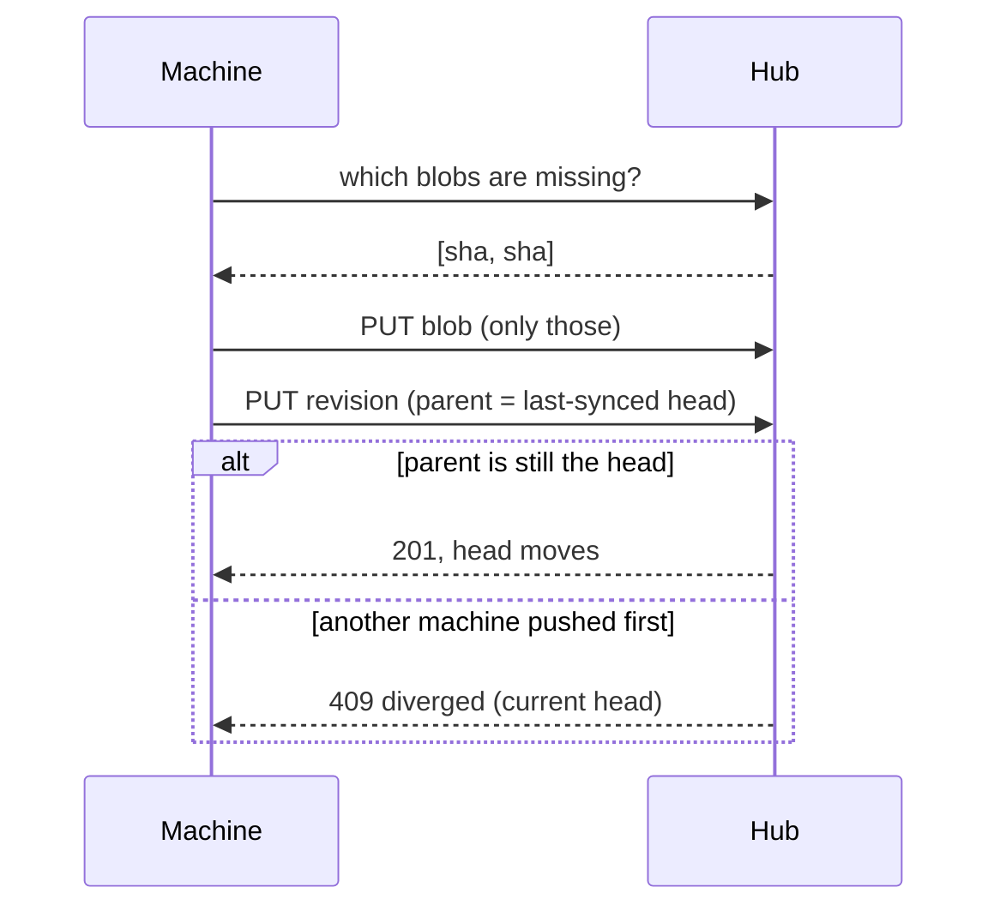

## Identity

A session is the same session when its **agent and native id** match — never because of its path or timestamps. The path only decides *where a pull lands*. Two separately started sessions in one repository are never merged, and timestamps are shown but never decide anything: clocks differ between machines, and a rename does not move a session's timestamp.

## Revisions

Each push uploads the session's files as content-addressed **blobs** (a file the hub already has is not uploaded again — a one-line change to a transcript uploads one blob), then a **revision** naming them, then moves the session's **head**. Each revision records the revision it started from (`parent_rev`).



Blobs go first, the revision second and the head last, so a crash mid-push leaves only unreferenced blobs. The hub refuses a revision whose parent is not the current head; that compare-and-swap is the entire concurrency story.

## The base

Each machine remembers, per session, the **last revision it agreed on with the hub** (`hub-state.json`). That *base* is how asm knows which side moved:

| Local vs. base | Hub head vs. base | Result |
|---|---|---|
| unchanged | unchanged | **Synced** |
| changed | unchanged | **Needs push** |
| unchanged | moved | **Needs pull** |
| changed | moved | **Diverged** |
| no record | exists | **Not compared**, until [compared](#comparing-without-pulling): then one of the above |

## Comparing without pulling

A session both sides have, but that this machine has never compared (there is no record of syncing it: a first run on a machine that already had the session, a deleted `hub-state.json`), starts as **Not compared**. asm then looks at it for you, in two steps, without installing anything.

**1. Identity.** It reads and hashes *this* machine's copy and compares the conversation's identity with the one the hub recorded when it was pushed. If they are equal the session is recorded as synced and shows **Synced**. This is the usual outcome for a session another machine pushed and this one already had.

**2. Content, when they differ.** Different identities do not say which side is ahead, and neither do sizes or timestamps: the two sides' sizes cover different files, and each machine's clock is its own. So asm downloads the hub's copy of the one file the agent compares — the transcript, rollout, snapshot or rows — and asks it the question a pull would ask, without writing anything: is this machine's copy a *prefix* of the hub's, is the hub's a prefix of this one, or neither? The answer is the row's state, exactly as if a sync record existed:

| Content shows | Row | What it records |
|---|---|---|
| the same conversation | **Synced** | the session as synced |
| the hub's copy extends this one | **Needs pull** | nothing |
| this copy extends the hub's | **Needs push** | the hub's revision as the base, as a pull would for a copy that is ahead, so the push that follows is accepted |
| each has something the other lacks | **Diverged** | nothing |

The comparison is the pull's own, per agent (Claude Code and Codex by transcript bytes, jcode by its message list, Antigravity by its transcript, OpenCode 1.x by its rows and 2.x by its messages and session fields), so what a row says is what `asm pull` would find. It is read-only for every agent, and it does not run `opencode`.

Reading the hub's copy is bounded. A listing reads it only when the hub's copy is at most **2 MiB**, and only within the 25 sessions each listing compares; the web UI's **Compare** button on one row reads up to **256 MiB**. Anything it cannot answer — a larger copy, an agent with nothing to compare by (an Antigravity conversation with no transcript, a jcode session whose latest turns are not yet in its snapshot, a bundle from the other OpenCode generation), a hub that stops answering — stays **Differs**, never an error, and a listing stops asking a hub that has failed to answer. What it works out is remembered until either side changes, and a result from a listing that did not read the hub's copy does not stand in for the larger Compare.

### The advisory lean

When the content could not be read, a row that still says **Differs** may carry a *lean*: this machine's copy looks newer when it was updated later than the hub's *and* is not smaller; the hub's copy looks newer the other way round; and when the time and the size point different ways there is no lean. It is a guess from two clocks and two sizes that cover different files, so it appears only in the row's hint and in `--json` (`compare.lean`), it never changes the row's state or what the row offers to do — pulling it is still how to find out, and nothing changes if it turns out this copy is ahead — and it is never used for any decision, a push or a pull.

Each listing compares at most 25 sessions, and remembers what it found, so a machine with thousands of uncompared sessions settles over a few refreshes instead of stalling the first. In the web UI's [Hub view](/guides/web-ui/#the-hub-view) a row's **Compare** button does one immediately.

## Diverged

Both machines continued the same session. Nothing is merged, and a pull of a diverged session installs nothing — it reports that it diverged. You choose which side wins:

```sh
asm push 7f3a1c88 --force     # this copy becomes the head
```

`--force` makes a new revision; the replaced copy stays on the hub as an earlier revision, so nothing is lost. To take the *other* machine's copy instead, delete the local one (`asm delete` backs it up first) and `asm pull` it.

## Pull obeys the safety model

A pull refuses a live session, never makes a second copy of an id, and only ever appends to a transcript that is a prefix of the hub's. See [Restore, per agent](/hub/restore/) for how each agent's pull works.

## What is never synced

Machine-local state stays out of the bundle: Claude's `sessions/<pid>.json`, background `jobs/`, per-project `memory/` and `~/.claude.json`; OpenCode's lock directory (1.x) and, on 2.x, a session's turn claim, its retry count and its queued input; jcode's `active_pids/`. Claude's `relocated` marker is machine-local state inside a shared byte stream, so it is stripped when comparing and re-derived on install.
